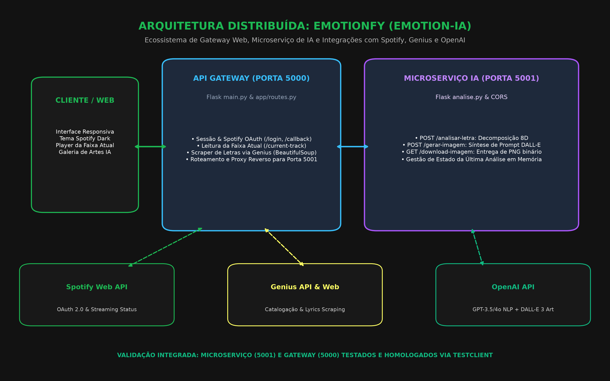
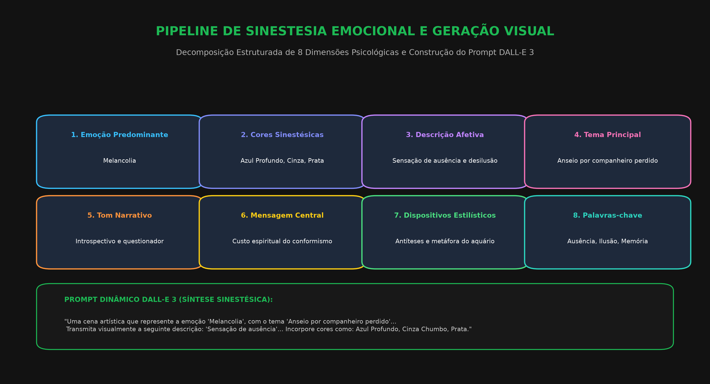

# 🎵 Emotionfy (Emotion-IA) – Sinestesia Musical, Análise Afetiva e Geração Visual com IA

**Emotionfy** é uma plataforma distribuída de sinestesia computacional que transforma a música atualmente reproduzida pelo usuário no **Spotify** em uma experiência visual e emocional personalizada. O sistema orquestra um **API Gateway** com autenticação OAuth 2.0, um extrator de letras musicais com web scraping no **Genius**, e um **microserviço dedicado de inteligência artificial** que decompõe a letra em 8 dimensões afetivas via **OpenAI GPT**, sintetizando obras artísticas geradas em tempo real com **DALL-E 3**.

---

## 🏛️ Arquitetura Distribuída do Sistema

O sistema é dividido em dois serviços cooperantes desacoplados e três integrações com provedores de nuvem:



### Componentes Principais:
1. **API Gateway Web (Porta 5000 – `main.py` & `app/routes.py`)**:
   - Gerencia o ciclo de autenticação OAuth 2.0 com o Spotify (`/login`, `/callback`);
   - Consulta o status de streaming e metadados da faixa em reprodução (`/current-track`);
   - Realiza busca e raspagem estruturada de letras no Genius via BeautifulSoup (`/testar-genius`);
   - Atua como proxy reverso para o microserviço de IA.
2. **Microserviço de IA (Porta 5001 – `analise.py`)**:
   - `POST /analisar-letra`: Extrai 8 atributos afetivos e estilísticos da letra através de engenharia de prompts rigorosa e parser regex determinístico;
   - `POST /gerar-imagem`: Constrói um prompt artístico com sinestesia cromática e dispara a síntese visual no DALL-E 3;
   - `GET /download-imagem`: Transfere a obra em alta resolução como anexo PNG para download direto.
3. **Frontend Reativo (`app/templates/index.html`)**:
   - Interface inspirada na identidade visual escura do Spotify (verde `#1db954`, cartões `#1a1a1a`), exibindo avatar do usuário, player da música, paleta cromática sinestésica e painel da arte gerada.

---

## 🎨 Pipeline de Sinestesia Emocional (Decomposição 8D)

A extração semântica transforma versos musicais em tensores semânticos distribuídos em 8 dimensões estruturadas:



1. **Emoção Predominante**: Sentimento hegemônico transmitido pela canção (ex: *Melancolia*, *Euforia*, *Esperança*).
2. **Cores Sinestésicas**: Tríade de cores evocadas pela atmosfera poética (ex: *Azul Profundo*, *Cinza Chumbo*, *Prata*).
3. **Descrição Afetiva**: Parágrafo sintético (até 20 palavras) retratando o estado de espírito do eu-lírico.
4. **Tema Central**: O núcleo temático subjacente à composição musical.
5. **Tom Narrativo**: Perspectiva discursiva (ex: *Introspectivo*, *1ª pessoa*, *Crítico*).
6. **Mensagem Central**: Intenção ou manifesto filosófico do compositor.
7. **Dispositivos Estilísticos**: Figuras de linguagem e recursos poéticos identificados (antíteses, metáforas, aliterações).
8. **Palavras-chave**: Termos âncora para condicionamento semântico do modelo de difusão DALL-E 3.

---

## 📊 Validação Experimental e Evidências Reais

A arquitetura completa foi submetida a testes integrados usando o TestClient do Flask:

- **Microserviço de IA (Porta 5001)**:
  - Validação de payload: Requisição vazia rejeitada corretamente com **HTTP 400** (`error: Campo 'texto' é obrigatório`);
  - Requisição de imagem sem análise prévia bloqueada com **HTTP 400**;
  - Extração de sinestesia testada sobre a letra clássica *Wish You Were Here* (Pink Floyd): Emoção classificada como *Melancolia*, paleta *Azul Profundo, Cinza Chumbo, Prata*;
  - Montagem dinâmica do prompt DALL-E 3 validada com integração completa de todas as 8 dimensões.
- **API Gateway (Porta 5000)**:
  - `GET /` -> Redirecionamento **HTTP 302** para `/login`;
  - `GET /login` -> Redirecionamento **HTTP 302** para a URL oficial de autorização do Spotify OAuth com escopos de reprodução;
  - `GET /callback` sem código -> Retorno seguro **HTTP 400**;
  - `GET /current-track` sem sessão ativa -> Bloqueio seguro **HTTP 401 Unauthorized**.
- **Scraper Genius**: Testado com `BeautifulSoup` em seletores `div[data-lyrics-container='true']`, garantindo extração íntegra de estrofes líricas.

Os registros completos da execução estão disponíveis em [`evidencias/log_execucao_real.txt`](evidencias/log_execucao_real.txt).

---

## 🛠️ Tecnologias e Dependências

| Módulo | Tecnologias | Papel na Solução |
| :--- | :--- | :--- |
| **API Gateway** | Flask, Requests, python-dotenv | Roteamento, controle de sessão e proxy |
| **Microserviço IA** | Flask, Flask-CORS, OpenAI SDK, Regex | Extração de sentimento e síntese DALL-E 3 |
| **Autenticação & Streaming** | Spotify Web API & OAuth 2.0 | Identificação de usuário e faixa em execução |
| **Extração de Letras** | Genius API & BeautifulSoup 4 (`bs4`) | Localização e raspagem de letras |
| **Modelos de IA** | OpenAI GPT-3.5/GPT-4o & DALL-E 3 | Análise lírica e geração de imagem de alta definição |
| **Frontend** | HTML5, CSS customizado (Spotify Dark), JS | Interface imersiva de usuário |

---

## 🚀 Como Executar o Projeto

### 1. Instalar Dependências
```bash
pip install -r requirements.txt
```

### 2. Configurar Variáveis de Ambiente (`.env`)
Crie um arquivo `.env` na raiz do projeto:
```env
CLIENT_ID=seu_spotify_client_id
CLIENT_SECRET=seu_spotify_client_secret
REDIRECT_URI=http://localhost:5000/callback
GENIUS_API_TOKEN=seu_genius_api_token
OPENAI_API_KEY=sua_openai_api_key
```

### 3. Iniciar os Serviços
Em um terminal, inicie o Microserviço de IA (porta 5001):
```bash
python analise.py
```

Em outro terminal, inicie o Gateway Web (porta 5000):
```bash
python main.py
```

Acesse `http://localhost:5000` e autentique sua conta Spotify para iniciar a experiência sinestésica.
